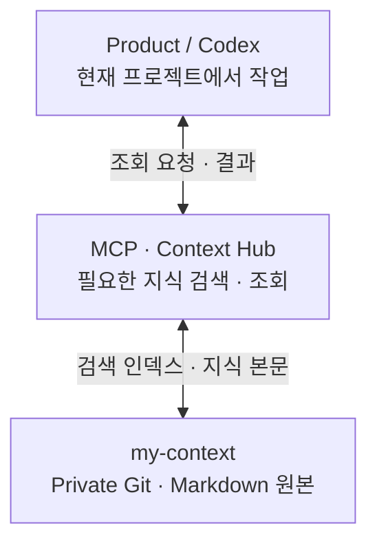

# my-context

**프로젝트가 바뀌어도, 내 개발 경험과 판단 기준을 매번 다시 설명할 필요가 없어요.**

AI와 개발하면서 쌓인 경험은 대화나 프로젝트 안에 남기 쉽습니다. 다른 프로젝트를 시작하면 이전 기록을 다시 찾아야 하고, 개인적인 원칙을 `AGENTS.md`마다 복사하면 프로젝트 규칙과 섞일 수도 있어요.

my-context는 **개인 개발 지식을 Git의 Markdown으로 보관**하고, 필요할 때 Codex가 찾아 현재 작업의 참고 자료로 사용할 수 있게 연결합니다.

## 실제로 사용해 보면

예를 들어 API 개발이 늦어졌을 때 MSW로 화면 개발을 먼저 진행했던 경험을 다른 프로젝트에서도 활용하고 싶다고 해볼게요.

**먼저, 경험을 남깁니다.**

```text
API가 준비되지 않았을 때 MSW로 화면 개발을 먼저 진행한 경험을
내 개발 지식에 등록해줘. 기존 지식과 비교하고 변경안을 보여줘.
```

Codex는 기존 내용을 확인하고 저장할 Markdown을 제안합니다. **변경안과 반영 범위를 승인하면** 지식을 저장하고 검색할 수 있게 갱신합니다.

**다른 프로젝트에서는 이렇게 찾아봅니다.**

```text
이 프로젝트도 API 준비가 늦어지고 있어.
내 개발 지식에서 비슷한 경험을 찾아 참고해줘.
```

예를 들어 저장해 둔 MSW 활용 경험을 참고해 **화면 개발을 먼저 진행하는 방안**을 제안하고, 실제 API 계약이 확정되기 전에 확인할 부분을 함께 짚어줄 수 있어요.

*사용 흐름을 보여주기 위한 예시입니다. 현재는 검증용 지식을 정리한 상태이며, 실제 개인 지식이 등록돼 있지는 않습니다.*

## 어떻게 동작하나요?

지식은 프로젝트 밖에 두고, **요청했을 때 필요한 내용만 읽습니다.**



my-context의 Markdown으로 Context Hub 검색 인덱스를 만들고, Codex는 MCP를 통해 관련 지식을 찾아 읽습니다. **MCP는 조회 인터페이스일 뿐** 지식의 원본이나 프로젝트의 판단을 소유하지 않아요.

조회한 지식은 **명령이 아닌 참고 Context**입니다. 현재 프로젝트의 요구사항과 규칙이 우선하며, 구현과 검증도 그 프로젝트에서 진행합니다. 여러 프로젝트에서 쓸 **공통 Skill**도 my-context에서 관리하지만, MCP가 아닌 Codex의 Skill 기능으로 사용해요.

## 왜 프로젝트마다 지식을 저장하지 않나요?

개인 경험을 프로젝트마다 복사하면 같은 내용을 여러 곳에서 관리해야 하고, 프로젝트 고유의 규칙과 섞이기 쉬워요. my-context는 **지식의 원본을 한곳에 두고, 필요한 프로젝트에서 찾아 읽도록** 연결합니다.

`AGENTS.md`에는 해당 프로젝트의 지침을 남깁니다. 실행과 테스트를 위한 Harness도 그 프로젝트에서 관리해요.

## 설치 및 첫 사용

macOS의 로컬 Codex와 Node.js **18 이상**이 필요합니다. Private 저장소에 접근할 수 있는 환경에서 실행하세요.

```bash
git clone git@github.com:SEONGMINY/my-context.git
cd my-context
npm ci
npm run setup
npm run build
npm run install:user
```

설치 명령은 Codex에 `personal-knowledge` MCP 설정을 등록하고 `manage-dev-knowledge` Skill을 연결합니다. **설정 등록과 실제 연결 성공은 다르므로**, 새 Codex 세션에서 먼저 확인하세요.

```text
personal-knowledge MCP의 chub_list를 직접 호출해줘.
```

도구 호출이 성공하면 연결된 것입니다. **현재는 지식이 없어 빈 목록이 나오는 것이 정상**이에요. 이후 위의 지식 등록 예시부터 시작하면 됩니다. Skill이 자동으로 선택되지 않으면 `$manage-dev-knowledge`로 호출할 수 있어요.

지식은 **명시적으로 요청할 때만** 조회하며, 저장·수정과 원격 반영에는 승인이 필요합니다. 현재 검색은 이름·설명·태그 중심이며 한국어 본문 의미 검색은 지원하지 않아요.

자세한 변경·검증 절차는 [관리 Skill](skills/manage-dev-knowledge/SKILL.md)에, 프로젝트의 방향과 출발점은 [VISION](docs/VISION.md)과 [PROBLEM](docs/PROBLEM.md)에 정리했습니다.
