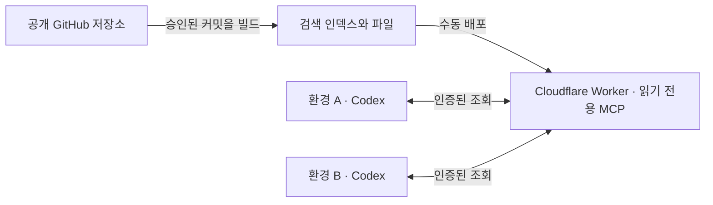

# my-context

**여러 프로젝트와 환경에서 개발 원칙과 작업 절차를 다시 쓸 수 있어요.**

my-context는 개발 원칙, 작업 절차, 템플릿, 보조 스크립트를 관리해요. 이 GitHub 저장소에서 소스 코드와 등록한 자산의 원본을 볼 수 있어요. Codex는 원격 MCP에서 작업에 필요한 자산을 조회해요.

## Codex에 연결하기

운영 MCP에는 허용된 계정만 연결할 수 있어요. 작업 환경마다 MCP 연결을 한 번 등록해 주세요. 운영자가 허용한 이메일로 로그인해 주세요. [사용자 추가](docs/DEPLOYMENT.md#운영-사용자-추가)

1. 아래 명령으로 연결을 등록해 주세요.

   ```bash
   codex mcp add my-context \
     --url https://minylee.my-context.workers.dev/mcp
   ```

2. 브라우저에서 **my-context**에 로그인해 주세요.

   - 터미널에 로그인 링크가 나오면 그 링크를 열어 주세요.
   - 로그인 안내가 없으면 `codex mcp login my-context`를 실행해 주세요.

3. 새 Codex 세션을 열어 주세요.
4. “`my-context`의 `chub_list`를 호출해줘”라고 요청해 주세요.

`chub_list`가 빈 목록을 반환해도 연결은 성공한 거예요. 이전 주소를 사용 중이면 위 명령으로 연결을 다시 등록해 주세요.

## 사용 예시

운영 MCP에 관련 자산이 있으면 다음과 같이 요청해 보세요.

```text
my-context에서 내 도메인 스토리텔링 절차를 찾아줘.
그 절차의 템플릿으로 이 프로젝트의 업무 흐름을 정리해줘.
```

조회한 자산은 현재 프로젝트의 규칙에 맞춰 적용해 주세요. 스크립트는 해당 프로젝트에서 실행해 주세요. 한글 검색 결과가 없으면 `domain storytelling`처럼 관련 영문 키워드를 써 보세요.

## 공통 개발 Workflow Skill

요구사항 구체화, 작업 분해, 검증, 중요 결정 변경, 세션 인계에 사용할 수 있는 선택적 Skill이에요. 작은 수정에는 별도 작업 문서를 만들지 않아요.

```bash
npm run install:workflow -- --check
npm run install:workflow
npm run test:workflow
```

설치 스크립트는 Codex·Pi가 사용하는 `~/.agents/skills/`와 Claude Code의 `~/.claude/skills/`에 같은 Skill 원본을 연결해요. 기존 파일이 있으면 덮어쓰지 않고 중단해요. 새 세션에서 `development-workflow`를 실제로 찾아 호출해 확인해 주세요. 도구별 로딩은 설치와 별개로 검증해야 해요.

개발 Workflow를 사용하는 것만으로 개인 지식 MCP를 조회하지 않아요. 각 프로젝트의 계약·승인 정책이 우선해요.

## 조회와 배포



[운영 배포 방법](docs/DEPLOYMENT.md#운영-배포)
