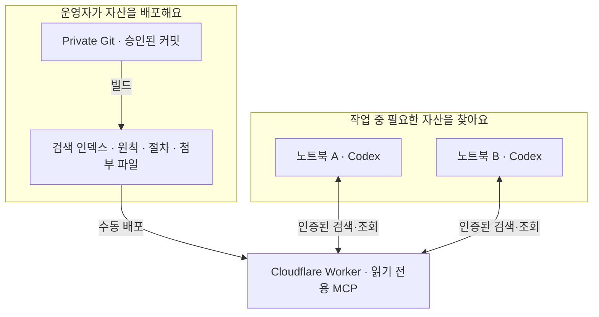

# my-context

**프로젝트나 노트북이 바뀌어도, 내 개발 경험과 판단 기준을 매번 다시 설명할 필요가 없어요.**

AI와 작업하며 쌓은 경험은 대화나 프로젝트 안에 남기 쉬워요. my-context는 **개인 원칙과 재사용할 작업 절차를 비공개 Git 저장소에 보관**하고, Codex가 필요할 때 MCP로 찾아 쓸 수 있게 해요. 절차에 딸린 템플릿이나 보조 스크립트도 함께 가져올 수 있습니다.

## 실제로 사용해 보면

새 프로젝트에서 요구사항을 받았고, 저장해 둔 도메인 스토리텔링 방식으로 업무 흐름을 정리하고 싶다고 해볼게요.

```text
my-context에서 내 도메인 스토리텔링 절차와 결과물 템플릿을 찾아줘.
이 프로젝트의 요구사항을 바탕으로 행위자와 업무 흐름을 정리해줘.
```

Codex는 저장된 절차를 찾아 필요한 질문을 짚고, 템플릿으로 결과를 정리해요. 테스트 코드가 고민이라면 “내 테스트 코드 원칙을 찾아 이 변경에 적용해줘”라고 요청할 수도 있습니다. 두 요청은 등록해 둔 자산이 있을 때의 사용 예시예요.

개인 자산은 **요청했을 때만** 읽어요. 적용할 때는 현재 프로젝트의 요구사항과 규칙을 우선하며, 스크립트 실행과 결과 검증도 해당 프로젝트에서 진행합니다.

## 어떻게 동작하나요?



Codex는 **Worker에 배포된 버전**을 읽어요. Git에 변경을 커밋하면 운영자가 Worker를 다시 배포하고, 두 노트북은 같은 주소에서 새 버전을 조회합니다.

## Codex에 연결하기

사용하는 환경마다 **원격 MCP 주소와 Bearer 토큰을 한 번 등록**하면 돼요. 조회하는 기기에는 저장소를 클론하거나 Skill을 따로 설치할 필요가 없습니다.

- **주소** — `https://my-context.my-context.workers.dev/mcp`
- **연결 방식** — Streamable HTTP
- **인증** — 운영자가 공유한 Bearer 토큰

Codex CLI에서는 토큰을 실행 환경의 `MY_CONTEXT_MCP_TOKEN`에 설정한 후 연결을 등록하세요.

```bash
codex mcp add my-context-cloudflare \
  --url https://my-context.my-context.workers.dev/mcp \
  --bearer-token-env-var MY_CONTEXT_MCP_TOKEN
```

데스크톱 앱을 사용한다면 앱이 토큰을 읽을 수 있도록 실행 환경에 전달하거나, 토큰 파일을 읽는 로컬 헤더 명령을 연결할 수 있어요. 헤더 명령을 사용할 때 `http_headers_helper`에는 명령을 문자열로 넣습니다. [Codex MCP 연결 안내](https://learn.chatgpt.com/docs/extend/mcp)

새 Codex 세션에서 이렇게 물어보세요.

```text
my-context-cloudflare의 chub_list를 직접 호출해줘.
```

호출이 성공하면 연결된 거예요. 배포된 자산이 없으면 빈 목록이 나와요. `401`이 나오면 Codex 실행 환경에서 토큰을 읽을 수 있는지 확인해 주세요. 검색은 이름·설명·태그를 사용하므로 한국어 요청으로 찾기 어렵다면 `testing`처럼 관련 영문 키워드를 함께 써 보세요.

## 자산을 등록하고 갱신하기

| 저장할 것 | 어디에 두나요? |
| --- | --- |
| 원칙이나 경험 | `content/personal/` 아래 항목 폴더에 본문 `knowledge.md`와 검색용 `SKILL.md`를 함께 둬요. |
| 반복해서 쓰는 절차 | `skills/` 아래에 폴더를 만들고 `SKILL.md`의 `name`을 폴더 이름과 맞춘 뒤 [배포 목록](publish-skills.json)에 추가해요. |
| 템플릿과 보조 스크립트 | 절차가 있는 폴더 안에 두면 MCP에서 필요한 파일만 가져올 수 있어요. |

등록·수정·삭제는 변경안을 검토하고 승인한 범위에서 반영해요. 배포할 변경은 먼저 Git에 커밋합니다. 기존 지식과 비교하거나 Markdown을 편집하는 절차는 [관리 Skill](skills/manage-dev-knowledge/SKILL.md)에 있어요.

운영자는 저장소와 Cloudflare 계정에 접근할 수 있는 환경에서 Node.js 22.22.0 이상으로 배포해요.

```bash
npm ci &&
npm run worker:build -- HEAD &&
npm run worker -- deploy --secrets-file /path/to/worker-secrets.env
```

비밀 파일은 저장소 밖에 두고 `MY_CONTEXT_MCP_TOKEN`에 접속 토큰을 설정해요. 다른 Cloudflare 계정에 배포했다면 Wrangler가 반환한 `workers.dev` 주소 뒤에 `/mcp`를 붙여 사용하세요.

<details>
<summary>운영자가 로컬에서 확인하는 방법</summary>

- **Worker 확인** — Git 커밋을 `npm run worker:build -- HEAD`로 빌드하고 `.dev.vars`에 테스트 토큰을 넣은 뒤 `npm run worker -- dev`를 실행해요.
- **기존 로컬 Context Hub 설치** — `npm ci` → `npm run setup` → `npm run build` → `npm run install:user` 순서예요. `npm run install:user -- --check`로 설정을 점검할 수 있어요. 설치에는 macOS와 프로젝트가 지원하는 Node.js 버전이 필요합니다.
- **로컬 HTTP 통합 테스트** — `node scripts/verify-release.mjs`는 임시 데이터로 릴리스 전환과 조회를 확인해요.

</details>

프로젝트가 지향하는 방향과 출발점은 [VISION](docs/VISION.md)과 [PROBLEM](docs/PROBLEM.md)에 정리했습니다.
