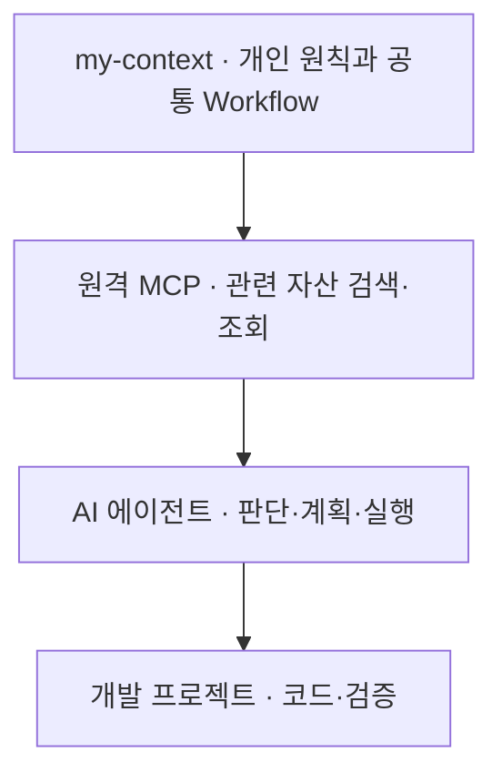

# my-context

my-context는 여러 프로젝트에서 개인 원칙과 AI 에이전트 작업 절차를 재사용하는 저장소예요. 프로젝트가 바뀌어도 같은 판단 기준을 반복해서 설명하지 않도록, **필요한 내용만 MCP로 찾아 활용**할 수 있어요.

## 어떻게 동작하나요?



my-context는 원칙과 절차를 제공하고, 실제 작업과 권한 판단은 각 프로젝트와 에이전트가 맡아요.

## 이런 상황에서 사용해요

| 이런 상황에서 | 무엇을 하나요? |
| --- | --- |
| [새 개발 세션에서 프로덕트를 이해할 때](skills/product-understanding/SKILL.md) | 현재 프로젝트의 목적·기능·코드 구조를 파악해요. |
| [프로덕트 문서를 점검할 때](skills/documentation-review/SKILL.md) | 실제 구현과 비교해 문서의 불일치·불필요·누락을 검토해요. |
| [요구사항과 의도가 모호할 때](content/personal/lookup-context-aware-reasoning/knowledge.md) | 필요한 질문으로 목표와 범위를 명확히 해요. |
| [업무 흐름을 인터뷰할 때](skills/domain-storytelling/SKILL.md) | AS-IS/TO-BE 스토리를 통해 업무와 요구사항을 파악해요. |
| [구현 방법이 고민될 때](content/personal/lookup-implementation-strategy/knowledge.md) | 기존 코드와 계약을 확인하고 구현 대안을 비교해요. |
| [작업이 복잡해졌을 때](skills/development-workflow/SKILL.md) | Phase·의존성·완료 기준과 검증 계획을 정리해요. |
| [코드 구조가 복잡할 때](content/personal/lookup-responsibility-driven-design/knowledge.md) | 모듈의 책임과 협력 관계를 검토해요. |
| [개발 경험을 정리할 때](skills/extract-development-insights/SKILL.md) | 다른 프로젝트에도 적용 가능한 인사이트 후보를 찾아요. |
| [지식을 등록하거나 수정할 때](skills/manage-dev-knowledge/SKILL.md) | 기존 자산을 검토하고 승인된 Git 변경·게시 절차를 따라요. |

## 시작하기

원격 MCP에 연결하고 운영자가 허용한 계정으로 로그인해 주세요.

1. Codex에 연결해 주세요.
   ```bash
   codex mcp add my-context --url https://minylee.my-context.workers.dev/mcp
   ```
2. 브라우저에서 로그인해 주세요. 필요하면 `codex mcp login my-context`를 실행해 주세요.
3. 새 세션에서 `my-context의 chub_list를 호출해줘`라고 요청해 연결을 확인해 주세요.
4. 이제 원하는 작업을 자연어로 요청하면 돼요.

새 개발 세션을 시작할 때는 **프로덕트 이해 → 문서 검토**를 한 번씩 수행하는 방식을 권장해요. 두 Skill은 독립적으로도 사용할 수 있으며, 모두 **읽기 전용**이에요. 문서 검토는 발견한 문제와 개선 방향만 보고하고 수정하지 않아요.

> my-context 사용해서 이 프로젝트의 목적·기능·코드 구조를 먼저 파악하고, 이어서 문서의 불일치·불필요·누락을 검토해줘. 수정은 하지 마.

MCP 자체는 세션 시작을 감지하거나 두 Skill의 자동 실행을 보장하지 않으므로 새 세션에서 위와 같이 요청해 주세요. 같은 세션의 후속 Task에서는 이미 확인한 내용을 재사용하고 전체 점검을 반복하지 않아요.

다른 예시:

> my-context 사용해서 지금까지 논의한 대화를 토대로 구현 계획을 Phase로 나눠서 세워줘.

AI는 관련 자산을 선택적으로 검색·조회하고 필요한 Workflow를 적용해요. **계획만 요청하면 계획을 제시하고 실행하지 않아요.** 처음부터 실행까지 요청하면 승인된 범위 내에서 진행하되, 배포·중요 변경 등 별도 승인이 필요한 작업에는 기존 권한 정책을 따라요.

> my-context 사용해서 이 프로젝트에서 얻은 인사이트를 기존 지식과 비교하고 등록 계획 세워줘.

관리 절차도 MCP로 읽을 수 있지만 **MCP는 읽기 전용**이에요. 실제 지식 원본의 등록·수정·게시에는 접근 가능한 Git 작업 환경과 사용자 승인이 필요해요.

명시적 요청 없이 AI가 자율적으로 자산을 발견할 수도 있지만, 이는 에이전트·모델의 도구 선택에 따라 달라져요. 명시적인 `my-context 사용해서 ...` 요청이 기본 사용 방법이에요. 연결·인증 문제는 [진단 안내](docs/MCP-USAGE.md)를 참고해 주세요.

> **공개 범위:** Git 원본은 공개되어 있어요. Cloudflare Access는 운영 MCP 접속만 제한하므로 민감한 내용을 커밋하기 전에 공개 범위를 확인해 주세요.

## 더 알아보기

- [MCP 연결과 진단](docs/MCP-USAGE.md)
- [개발 지식 관리](skills/manage-dev-knowledge/SKILL.md)
- [개발 안내](AGENTS.md) · [운영과 배포](docs/DEPLOYMENT.md) · [E2E 검증](test/workflow-evaluation.md)
