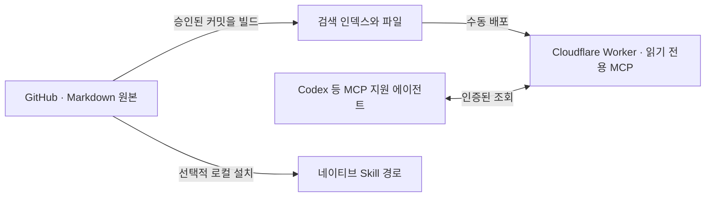

# my-context

my-context는 여러 프로젝트에서 쓸 개발 원칙과 에이전트 작업 절차를 모아 둔 저장소예요. 자산 원본은 GitHub에서 관리하고, **MCP에서 필요한 내용을 조회하거나** 자주 쓰는 Skill을 로컬에 설치할 수 있어요.

> **공개 범위:** 이 GitHub 저장소는 현재 공개(`public`) 상태예요. 커밋된 개인 지식은 GitHub에서 누구나 읽을 수 있고, Cloudflare Access 인증은 **운영 MCP 접속**에 적용돼요. 비공개 정보는 원본에 커밋하기 전에 공개 범위를 확인해 주세요.

## 포함된 항목

| 항목 | 언제 쓰나요? | 사용 경로 |
| --- | --- | --- |
| [`development-workflow`](skills/development-workflow/SKILL.md) | 요구사항을 정리하고 작업을 나눌 때. 변경을 검증하거나 작업을 인계할 때. | [MCP로 사용](#개발-workflow-사용하기) · [선택적 설치](#자주-사용한다면-설치하기) |
| [`domain-storytelling`](skills/domain-storytelling/SKILL.md) | 인터뷰로 현재 업무를 파악하고 개선 범위와 요구사항을 정리할 때. | [워크숍 양식](skills/domain-storytelling/templates/workshop-documents.md) · MCP 배포 대상 |
| [`extract-development-insights`](skills/extract-development-insights/SKILL.md) | 개발 대화의 사용자 발언·결정·대안을 분석해 재사용할 원칙 후보를 찾을 때. | MCP 배포 대상 · 읽기 전용 |
| [Implementation Strategy](content/personal/lookup-implementation-strategy/knowledge.md) | 기존 코드·책임·인터페이스를 검토해 구현 방향을 결정할 때 | 독립 지식 · MCP 조회 |
| [Execution Strategy](content/personal/lookup-execution-strategy/knowledge.md) | 작업·맥락 의존성, 실행 방식과 정보 공유의 적합성을 판단할 때 | 독립 지식 · MCP 조회 |
| [Roadmap Planning](content/personal/lookup-roadmap-planning/knowledge.md) | 단기 구현과 이후 확장 조건을 구분할 때 | 독립 지식 · MCP 조회 |
| [Context-aware Reasoning](content/personal/lookup-context-aware-reasoning/knowledge.md) | 요구사항·설계·계획 등 질문에 적절한 판단 기준을 선택할 때 | 독립 지식 · MCP 조회 |
| [Risk Management](content/personal/lookup-risk-management/knowledge.md) | 계획의 실패 가능성과 위험 대응을 검토할 때 | 독립 지식 · MCP 조회 |
| [Preventive Engineering](content/personal/lookup-preventive-engineering/knowledge.md) | 장기적인 재발 방지와 구조적 통제의 필요성을 검토할 때 | 독립 지식 · MCP 조회 |
| [테스트 작성 원칙](content/personal/lookup-testing-principles/knowledge.md) | 무엇을 테스트할지 정하고 테스트 결과가 실제 동작을 보여주는지 검토할 때. | GitHub에서 읽기 · MCP 배포 대상 |
| [`manage-dev-knowledge`](skills/manage-dev-knowledge/SKILL.md) | 이 저장소에 지식을 추가하거나 수정할 때. | 저장소 내 관리 Skill |

## 시작하기

| 목적 | 사용 경로 |
| --- | --- |
| 개인 원칙이나 게시된 공통 Skill 조회 | 원격 `my-context` MCP |
| development-workflow 네이티브 호출 | 선택적 로컬 설치 |
| 관련 개인 원칙의 선택적 자동 조회 | 원격 MCP + 사용자 범위 조회 정책 |
| 개인 지식 관리 | 저장소 원본 + 관리 Skill (선택적으로 로컬 관리 MCP) |

원격 MCP는 Git 커밋으로 게시한 개인 지식과 공통 Skill을 제공해요. 로컬 관리 MCP(`personal-knowledge`)는 현재 체크아웃의 `content/`를 빌드한 개인 지식만 제공해요. 원격 Worker의 한국어 보완 검색과 배포 `revision` 응답은 로컬 관리 MCP의 계약이 아니에요.

### my-context MCP 연결하기

MCP를 통한 사용에는 **Skill 설치나 저장소 클론이 필요하지 않아요.** 먼저 사용할 에이전트에 my-context MCP를 한 번 연결해 주세요. 현재 Codex 연결 방법은 아래와 같아요. 운영자가 허용한 이메일로 로그인해야 해요. [사용자 추가](docs/DEPLOYMENT.md#운영-사용자-추가)

1. Codex에서 MCP를 연결해 주세요.

   ```bash
   codex mcp add my-context \
     --url https://minylee.my-context.workers.dev/mcp
   ```

2. 브라우저에서 **my-context**에 로그인해 주세요.
   - 터미널에 로그인 링크가 나오면 그 링크를 열어 주세요.
   - 로그인 안내가 없으면 `codex mcp login my-context`를 실행해 주세요.
3. 새 에이전트 세션을 열고 "my-context의 `chub_list`를 호출해줘"라고 요청해 연결을 확인해 주세요.

Pi나 Claude Code에서는 해당 버전의 MCP 연결·인증 절차를 따라야 해요. 연결 후 `chub_list` 호출로 실제 사용 가능 여부를 확인해 주세요. **로컬 Skill 설치만으로 MCP까지 연결되지는 않아요.** 에이전트별 발견·실제 적용 검증은 [E2E 가이드](test/workflow-evaluation.md)를 참고해 주세요.

### 원칙을 Skill과 독립적으로 활용하기

개인 개발 원칙은 `development-workflow`의 하위 문서가 아니에요. 요구사항 분석·기술 설계·로드맵 검토처럼 코드를 작성하지 않는 작업에서도 필요한 자산만 선택해 사용할 수 있어요.

**기본값은 개인 지식 자동 조회 비활성화**예요. 원칙이 필요한 요청에는 `my-context에서 Implementation Strategy 원칙을 찾아 적용해줘`처럼 명시적으로 말하면 돼요. 여러 프로젝트에서 관련 원칙을 선택적으로 활용하고 싶다면, 다음과 같이 **사용자 범위의 조회 정책을 직접 활성화**할 수 있어요.

```bash
# 저장소 루트에서 대상 경로와 정책 상태를 확인
node scripts/install-asset-usage.mjs --check

# 개인 자산의 선택적 읽기 전용 조회를 직접 허용
node scripts/install-asset-usage.mjs --enable

# 다시 비활성화
node scripts/install-asset-usage.mjs --disable
```

`--check`는 파일을 변경하지 않고 각 대상의 상태를 보여줘요. `disabled`는 미설치, `enabled`는 현재 정책과 일치, `outdated`는 이전 정책이 설치된 상태예요. 갱신하려면 원본을 검토한 뒤 `--enable`을 다시 실행해 주세요. 기존 사용자 지침은 보존하며 관리 구간이 수정됐거나 손상되면 중단해요. [정책 및 설치 상세](docs/LOCAL-SETUP.md#선택적-조회-정책)

활성화 후에는 **새 에이전트 세션**을 열고 해당 환경에 `my-context` MCP가 연결·인증돼 있는지 확인해 주세요. 지침 파일이 존재해도 실제 MCP 조회와 모델 적용은 자동으로 보장되지 않아요. 프로젝트의 기존 지침·권한과 충돌하면 그 정책을 우선해요. 사용자가 조회를 금지하면 호출하지 않아요.

자동 조회가 허용된 환경에서도 모든 요청마다 검색하지 않아요. 관련 원칙이 답변의 판단에 도움이 될 가능성이 높을 때만 `chub_search` → `chub_get`으로 필요한 항목을 읽고, 오타 수정 등 간단한 작업은 건너뛰어요. **읽기 권한은 지식 변경·설치·배포 권한을 포함하지 않습니다.** 이 설정은 도구나 MCP를 자동 설치하지 않아요. 이는 에이전트가 따를 행동 지침이며, 서버에서 사용자 동의를 호출별로 검증하는 접근 제어는 아니에요.

### 개발 Workflow 사용하기

MCP가 연결돼 있다면 아래처럼 요청해 주세요.

```text
my-context에서 development-workflow를 찾아서 이번 프로젝트에 적용해줘.
필요할 때만 참조 문서를 읽고, 로컬에 새 Skill을 설치하지는 마.
```

에이전트는 기존 `chub_search`에서 `workflows/development-workflow`를 찾고, `chub_get`으로 `SKILL.md`를 읽어 적용할 수 있어요. 구조화된 계획이나 인계 등으로 공통 계약이 필요할 때만 `references/contracts.md`를 추가 조회하면 돼요.

MCP로 읽은 지침을 **현재 작업에 적용하는 것**과 네이티브 Skill을 **로컬에 설치하는 것**은 달라요. MCP에서 읽었다고 Skill 목록에 자동 등록되지는 않아요.

- MCP 연결 또는 인증이 실패하면 연결을 확인해 주세요. 조회되지 않았는데 적용했다고 주장해서는 안 돼요.
- 검색 결과에 Skill이 없다면 마지막 [운영 배포](docs/DEPLOYMENT.md#운영-배포)에 해당 Skill이 포함됐는지 확인해 주세요.
- 현재 Worker 구현은 `chub_search`·`chub_list`에서 `revision`(배포 커밋 SHA)을 반환해요. 아직 이전 Worker를 사용 중이라면 이 필드가 없을 수 있어요. 운영 배포는 GitHub의 최신 소스와 다를 수 있어요.
- 현재 프로젝트의 요구사항과 규칙이 공통 Skill보다 우선해요. 기본적으로 개인 지식은 명시적 요청 시에만 조회하며, 사용자 수준에서 위의 선택적 조회 정책을 활성화한 경우에만 관련 자산을 필요할 때 읽어요.

### 자주 사용한다면 설치하기

여러 프로젝트에서 `development-workflow`를 자주 쓰고 네이티브 Skill 호출을 이용하고 싶다면 사용자 범위에 설치할 수 있어요. 현재 전용 설치기는 이 Skill만 지원해요. 관리 Skill은 아래 로컬 관리 환경에서 설치하며, 나머지 공통 Skill에는 전용 설치기가 없어요.

이 방법에는 Node.js·npm과 로컬 저장소가 필요해요. 지원 Node.js 버전과 환경 조건은 [로컬 설정 안내](docs/LOCAL-SETUP.md)를 확인해 주세요.

1. [저장소](https://github.com/SEONGMINY/my-context)를 클론하거나 이미 클론한 디렉터리로 이동해 주세요.
2. 저장소 루트에서 아래 명령을 실행해 주세요.

   ```bash
   npm run install:workflow -- --check
   npm run install:workflow
   ```

3. 새 에이전트 세션에서 `development-workflow`를 호출해 주세요.

| 에이전트 | 명시적 호출 |
| --- | --- |
| Codex | `$development-workflow` |
| Pi | `/skill:development-workflow` |
| Claude Code | `/development-workflow` |

설치기는 같은 로컬 원본을 가리키는 심볼릭 링크를 만들고 기존 사용자 Skill과 충돌하면 중단해요. 로컬 Skill은 로컬 체크아웃, 원격 MCP는 배포된 릴리스를 사용하므로 버전이 다를 수 있어요. [설치·갱신·제거 상세](docs/LOCAL-SETUP.md#workflow-skill).

일반 개발 요청에서 설치된 Skill을 자동으로 선택할지는 에이전트의 판단에 달려 있어요. 확실하게 적용하려면 명시적으로 호출해 주세요. [설치와 동작 검증](test/workflow-evaluation.md)

## 다른 자산 조회

운영 MCP에 도메인 스토리텔링이 배포됐다면 다음과 같이 요청할 수도 있어요.

```text
my-context에서 도메인 스토리텔링 절차를 찾아줘.
그 절차의 양식으로 이 프로젝트의 현재 업무 흐름을 정리해줘.
```

필요한 자산만 현재 프로젝트의 규칙에 맞춰 적용해 주세요. 원격 Worker는 한국어 보완 검색을 지원해요. 결과가 없으면 `domain storytelling`처럼 영문 키워드로도 검색해 주세요.

## 개발 경험에서 인사이트 찾기

개발 대화나 구현 이력을 검토하고 싶다면 해당 자산이 운영 MCP에 게시된 경우 다음처럼 요청할 수 있어요.

```text
my-context에서 extract-development-insights를 찾아 읽고,
이번 개발 대화에서 내가 제기한 문제·검토한 대안·실제 결정을 구분해줘.
다른 프로젝트에서도 쓸 원칙 후보와 기존 원칙의 중복을 확인해줘.
파일이나 지식은 수정하지 마.
```

추출 Skill은 **분석만** 수행해요. 사용자 발언과 AI의 제안, 실제 결과를 구분하고 근거가 부족하면 미확인으로 남겨요. 원칙을 실제로 저장·변경할 때는 별도 `manage-dev-knowledge` 절차와 승인이 필요해요.

GitHub의 최신 자산도 운영 배포 전에는 원격 MCP에 반영되지 않을 수 있어요.

## 개인 개발 지식 관리

원격 MCP의 `chub_search`·`chub_get`·`chub_list`는 **읽기 전용**이에요. 지식을 등록·수정·삭제하려면 저장소 원본을 확인하고 사용자 승인을 거치는 [`manage-dev-knowledge`](skills/manage-dev-knowledge/SKILL.md)를 사용해 주세요. 이 관리 Skill은 운영 MCP 게시 목록에 포함되지 않아요.

Codex에서 **로컬 관리 환경**을 사용할 경우 저장소 루트에서 다음 순서로 준비할 수 있어요. 이 경로는 원격 MCP 연결과 별개로 `personal-knowledge` 로컬 MCP와 관리 Skill을 사용자 범위에 설치해요. 기존 설정이 있다면 `--check` 결과를 먼저 검토해 주세요.

```bash
npm ci
npm run setup
npm run build
npm run install:user -- --check
npm run install:user
```

새 Codex 세션에서 실제 MCP 연결과 Skill 로딩을 각각 확인해 주세요. [로컬 관리 환경 제거 및 갱신](docs/LOCAL-SETUP.md#로컬-관리-환경). 파일을 변경할 때는 [관리 Skill의 승인 절차](skills/manage-dev-knowledge/SKILL.md)를 따라야 하며, 변경 사항을 운영 MCP에 반영하려면 별도 배포 검증이 필요해요.

## 조회와 배포

원격 MCP는 `chub_search`와 `chub_list`로 자산을 찾고, `chub_get`으로 기본 진입 파일(`SKILL.md` 또는 `DOC.md`)만 읽어요. 개인 지식 본문은 `file: knowledge.md`, 공통 Skill의 참조 문서는 해당 자산 안의 상대 경로를 `file`에 지정해 읽어요. `full: true`는 모든 첨부가 필요할 때만 사용해 주세요. 다른 자산이나 저장소 외부 문서가 같은 첨부 경로로 조회되는 것은 아니에요.



[운영 배포 방법](docs/DEPLOYMENT.md#운영-배포)
