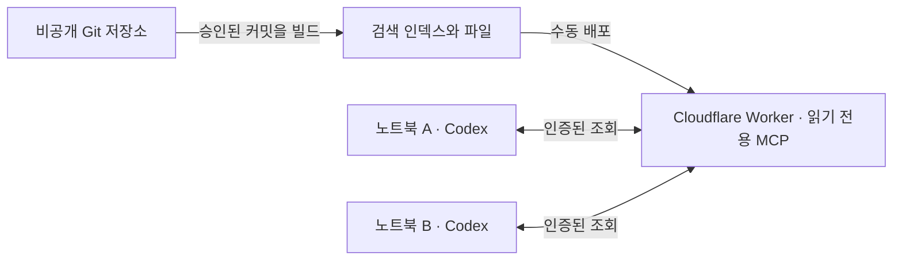

# my-context

**프로젝트나 노트북이 바뀌어도 내 개발 원칙과 작업 절차를 다시 쓸 수 있어요.**

my-context는 원칙, 작업 절차, 템플릿, 보조 스크립트를 비공개 Git 저장소에 보관해요. Codex는 요청을 받으면 같은 원격 MCP 주소에서 필요한 내용을 가져와요.

## Codex에 연결하기

노트북마다 MCP 연결을 한 번 등록해요. 운영자가 공유한 Bearer 토큰이 필요해요. [토큰을 받거나 만드는 방법](docs/DEPLOYMENT.md#토큰-준비)을 참고해 주세요.

1. Codex를 실행하는 환경에 `MY_CONTEXT_MCP_TOKEN`을 설정해 주세요.
2. 아래 명령으로 연결을 등록해 주세요.

   ```bash
   codex mcp add my-context-cloudflare \
     --url https://my-context.my-context.workers.dev/mcp \
     --bearer-token-env-var MY_CONTEXT_MCP_TOKEN
   ```

3. 새 Codex 세션을 열어 주세요.
4. “`my-context-cloudflare`의 `chub_list`를 호출해줘”라고 요청해 주세요.

빈 목록도 연결에 성공한 결과예요. `401`이 나오면 Codex가 Bearer 토큰을 읽을 수 있는지 확인해 주세요. 데스크톱 앱의 [연결 방법](docs/DEPLOYMENT.md#codex-데스크톱)은 배포 가이드에 있어요.

## 사용 예시

```text
my-context에서 내 도메인 스토리텔링 절차를 찾아줘.
그 절차의 템플릿으로 이 프로젝트의 업무 흐름을 정리해줘.
```

조회한 내용은 현재 프로젝트의 규칙에 맞춰 적용해요. 스크립트도 해당 프로젝트에서 실행해요. 검색 결과가 없다면 `testing`처럼 관련 영문 키워드를 써 보세요.

## 조회와 배포



Codex는 Worker에 배포된 버전을 조회해요. 각 노트북에는 MCP 연결만 등록하면 돼요.

개발 원칙은 `content/`에 보관해요. 재사용할 절차와 첨부 파일은 `skills/`에 보관해요. 변경 승인과 수동 배포는 [배포 가이드](docs/DEPLOYMENT.md)를 참고해 주세요.

제품의 방향과 출발점은 [VISION](docs/VISION.md)과 [PROBLEM](docs/PROBLEM.md)에 있어요.
