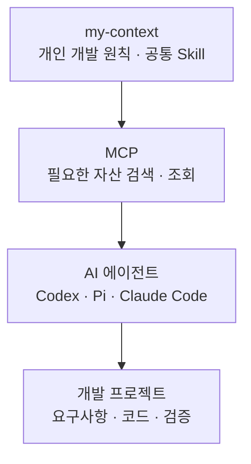

# my-context

my-context는 여러 프로젝트에서 쓸 개발 원칙과 AI 에이전트의 공통 작업 절차를 관리하는 저장소예요. 프로젝트나 에이전트가 바뀔 때마다 같은 판단 기준을 다시 설명하지 않고, **필요한 순간에 관련 원칙과 절차를 꺼내 쓸 수 있도록** 만들었어요.

## 어떻게 동작하나요?



my-context는 자산을 제공하고, AI 에이전트는 **현재 프로젝트의 요구사항과 코드를 우선해** 관련 내용을 적용해요. 실제 구현과 검증도 각 프로젝트에서 수행해요. 위 그림은 원격 MCP를 사용하는 흐름이며, 자주 쓰는 Skill은 [로컬에 설치](docs/LOCAL-SETUP.md#workflow-skill)할 수도 있어요.

## 이런 상황에서 사용해요

| 이런 상황에서 | 무엇을 하나요? |
| --- | --- |
| [구현 방법이 고민될 때](content/personal/lookup-implementation-strategy/knowledge.md) | 기존 코드와 계약을 확인하고 구현 대안을 비교해요. |
| [작업이 복잡해졌을 때](skills/development-workflow/SKILL.md) | 요구사항·작업 의존성·검증·인계 방식을 정리해요. |
| [코드 구조가 복잡할 때](content/personal/lookup-responsibility-driven-design/knowledge.md) | 구성 요소의 책임과 협력 관계를 검토해요. |
| [테스트를 정리할 때](content/personal/lookup-testing-principles/knowledge.md) | 중요한 동작을 골라 유지할 가치가 있는 테스트를 판단해요. |
| [반복되는 문제가 있을 때](content/personal/lookup-preventive-engineering/knowledge.md) | 실패 원인을 살펴보고 재발 방지가 필요한지 판단해요. |
| [개발 경험을 정리할 때](skills/extract-development-insights/SKILL.md) | 다음 프로젝트에서도 쓸 수 있는 원칙 후보를 찾아요. |

상황을 클릭하면 관련 원칙이나 Skill의 원문을 볼 수 있어요. 모든 원칙을 매번 적용하거나 하나의 상황에 하나의 자산만 사용하도록 강제하지는 않아요.

## 시작하기

원격 MCP를 사용하면 저장소를 클론하거나 Skill을 설치하지 않아도 돼요. **운영자가 허용한 이메일**로 로그인할 수 있어야 해요.

1. Codex에 연결해 주세요.

   ```bash
   codex mcp add my-context --url https://minylee.my-context.workers.dev/mcp
   ```

2. 브라우저에서 로그인해 주세요. 안내가 없다면 `codex mcp login my-context`를 실행해 주세요.
3. 새 세션에서 `my-context의 chub_list를 호출해줘`라고 요청해 실제 연결을 확인해 주세요.
4. 이제 평소처럼 원하는 작업을 요청하면 돼요.

   ```text
   my-context를 사용해서 지금 구현하려는 기능의 설계가 적절한지 검토해줘.

   my-context를 참고해서 이 작업의 구현 계획을 세워줘.

   my-context를 사용해서 코드의 책임 분리와 가독성을 검토해줘.
   ```

에이전트는 허용된 범위에서 관련 자산을 검색하고 필요한 본문만 읽은 다음, 현재 프로젝트를 기준으로 검토해요. **사용자가 원칙이나 Skill의 이름을 미리 알 필요는 없어요.** Pi나 Claude Code에서는 사용하는 버전에 맞는 MCP 연결·인증 절차를 따르고, [실제 조회](test/workflow-evaluation.md)로 확인해 주세요.

기본적으로 자산은 **명시적으로 요청했을 때** 조회해요. AI가 관련 개인 원칙과 공통 Skill을 선택적으로 자동 활용하도록 하려면 [사용자 범위 정책](docs/LOCAL-SETUP.md#선택적-조회-정책)을 직접 활성화해 주세요. MCP 연결이나 Skill 설치만으로 자동 활용에 동의한 것은 아니에요. 조회 권한은 지식 변경·설치·배포 권한과 별개예요.

> **공개 범위:** 이 GitHub 저장소는 현재 공개(`public`) 상태예요. 커밋한 개인 지식은 누구나 볼 수 있고, Cloudflare Access 인증은 **운영 MCP 접속만** 제한해요. 비공개 정보는 원본에 커밋하기 전에 공개 범위를 확인해 주세요.

## 어떤 자산이 있나요?

| 자산 | 역할 | 살펴보기 |
| --- | --- | --- |
| 개인 개발 원칙 | 설계·구현·실행·위험·테스트에 활용할 판단 기준 | [개인 원칙 예시](content/personal/lookup-implementation-strategy/knowledge.md) |
| 공통 Skill | 여러 프로젝트에서 재사용하는 작업 절차 | [개발 Workflow](skills/development-workflow/SKILL.md), [도메인 스토리텔링](skills/domain-storytelling/SKILL.md) |
| 활용 정책 | 어떤 동의 범위에서 자산을 조회할지 안내 | [자산 활용 정책](policies/asset-usage.md) |
| 지식 관리 | 개인 지식 조회와 승인된 등록·수정·삭제 절차 | [관리 Skill](skills/manage-dev-knowledge/SKILL.md) |

개인 원칙은 Workflow 없이도 사용할 수 있어요. 원격 MCP는 **게시된 개인 원칙과 공통 Skill을 읽기 전용으로** 제공하고, 관리 Skill은 원격에 게시하지 않아요. 지식 변경은 원본 저장소와 별도의 승인 절차를 통해 진행해요.

## 더 알아보기

- [로컬 설정](docs/LOCAL-SETUP.md) — 정책 활성화, 로컬 MCP, 네이티브 Skill 설치
- [제품 비전](docs/VISION.md) · [출발점이 된 문제](docs/PROBLEM.md) — 왜 만들었고 어디까지 책임지는지
- [개인 지식 관리](skills/manage-dev-knowledge/SKILL.md) — 지식 조회와 승인된 변경
- [운영과 배포](docs/DEPLOYMENT.md) — 운영 사용자, 게시, 배포 및 복구
- [실사용 검증](test/workflow-evaluation.md) · [개인 원칙 평가](test/principle-evaluation.md) — 에이전트 행동과 검증 기준

원격 MCP는 **배포된 Git 커밋**의 자산을 제공하고, 로컬에 설치한 Skill은 **my-context 저장소의 원본 파일**을 참조해요. 버전이 다를 수 있으니 문제가 생기면 [로컬 문제 해결](docs/LOCAL-SETUP.md#문제가-발생했을-때)이나 [배포 확인](docs/DEPLOYMENT.md#배포-확인)을 참고해 주세요.
