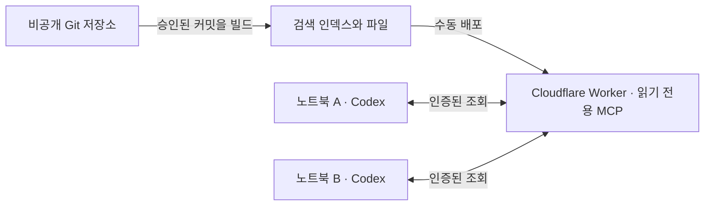

# my-context

**프로젝트나 노트북이 바뀌어도 내 개발 원칙과 작업 절차를 다시 쓸 수 있어요.**

my-context는 원칙, 작업 절차, 템플릿, 보조 스크립트를 비공개 Git 저장소에 보관해요. Codex는 요청을 받으면 같은 원격 MCP 주소에서 필요한 내용을 가져와요.

## Codex에 연결하기

노트북마다 MCP 연결을 한 번 등록해요. 운영자가 허용한 이메일로 브라우저에서 로그인해 주세요.

1. 아래 명령으로 연결을 등록해 주세요.

   ```bash
   codex mcp add my-context \
     --url https://minylee.my-context.workers.dev/mcp
   ```

2. 브라우저에서 **my-context**에 로그인해 주세요. 터미널에 로그인 링크가 나오면 브라우저에서 열어 주세요. 로그인 안내가 없으면 `codex mcp login my-context`를 실행해 주세요.
3. 새 Codex 세션을 열어 주세요.
4. “`my-context`의 `chub_list`를 호출해줘”라고 요청해 주세요.

빈 목록도 연결에 성공한 결과예요. 이전 URL을 쓰고 있다면 같은 이름으로 다시 등록해 주세요. [사용자 추가](docs/DEPLOYMENT.md#운영-사용자-추가)

## 사용 예시

관련 자산이 배포되어 있다면 이렇게 요청할 수 있어요.

```text
my-context에서 내 도메인 스토리텔링 절차를 찾아줘.
그 절차의 템플릿으로 이 프로젝트의 업무 흐름을 정리해줘.
```

조회한 내용은 현재 프로젝트의 규칙에 맞춰 적용해요. 스크립트도 해당 프로젝트에서 실행해요. 한글로 찾기 어려우면 `domain storytelling`처럼 관련 영문 키워드를 써 보세요.

## 조회와 배포



Codex는 마지막으로 배포한 Git 커밋의 자산을 조회해요. 변경을 커밋한 뒤 운영에 반영하려면 [배포 가이드](docs/DEPLOYMENT.md)를 따라 주세요.

제품의 방향과 출발점은 [VISION](docs/VISION.md)과 [PROBLEM](docs/PROBLEM.md)에 있어요.
