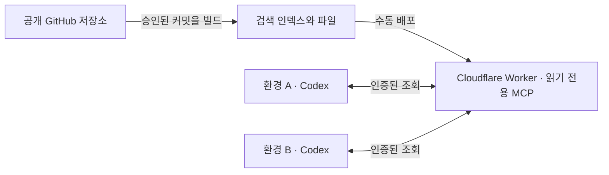

# my-context

my-context는 여러 프로젝트에서 쓸 개발 원칙과 에이전트 작업 절차를 모아 둔 저장소예요. 각 항목은 GitHub에서 읽을 수 있어요. 개발 Workflow는 로컬 Skill로 설치할 수 있고, 운영 MCP에서는 배포된 항목을 조회할 수 있어요.

## 포함된 항목

| 항목 | 언제 쓰나요? | 사용 경로 |
| --- | --- | --- |
| [`development-workflow`](skills/development-workflow/SKILL.md) | 요구사항을 정리하고 작업을 나눌 때. 변경을 검증하거나 작업을 인계할 때. | [로컬 설치](#개발-workflow-설치하기) · MCP 배포 대상 |
| [`domain-storytelling`](skills/domain-storytelling/SKILL.md) | 인터뷰로 현재 업무를 파악하고 개선 범위와 요구사항을 정리할 때. | [워크숍 양식](skills/domain-storytelling/templates/workshop-documents.md) · MCP 배포 대상 |
| [테스트 작성 원칙](content/personal/lookup-testing-principles/knowledge.md) | 무엇을 테스트할지 정하고 테스트 결과가 실제 동작을 보여주는지 검토할 때. | GitHub에서 읽기 · MCP 배포 대상 |
| [`manage-dev-knowledge`](skills/manage-dev-knowledge/SKILL.md) | 이 저장소에 지식을 추가하거나 수정할 때. | 저장소 내 관리 Skill |

## 시작하기

### 개발 Workflow 설치하기

Node.js와 npm이 필요해요.

1. 저장소를 클론해 주세요.
2. 저장소 루트에서 아래 명령을 실행해 주세요.

   ```bash
   npm run install:workflow -- --check
   npm run install:workflow
   ```

3. 새 에이전트 세션을 열어 주세요.
4. `development-workflow`를 호출해 주세요. Codex에서는 `$development-workflow`를 입력해요.

설치 명령은 Codex·Pi용 `~/.agents/skills/`와 Claude Code용 `~/.claude/skills/`에 같은 원본을 가리키는 링크를 만들어요. 기존 파일과 충돌하면 설치가 멈춰요. 각 도구의 새 세션에서 Skill이 보이는지 확인해 주세요. [설치와 동작 검증](test/workflow-evaluation.md)

### Codex에 연결하기

운영 MCP에서 필요한 원칙이나 작업 절차를 조회할 수 있어요. 운영자가 허용한 이메일이 필요해요. [사용자 추가](docs/DEPLOYMENT.md#운영-사용자-추가)

1. 작업 환경마다 아래 명령으로 MCP를 한 번 등록해 주세요.

   ```bash
   codex mcp add my-context \
     --url https://minylee.my-context.workers.dev/mcp
   ```

2. 브라우저에서 **my-context**에 로그인해 주세요.

   - 터미널에 로그인 링크가 나오면 그 링크를 열어 주세요.
   - 로그인 안내가 없으면 `codex mcp login my-context`를 실행해 주세요.

3. 새 Codex 세션을 열어 주세요.
4. “`my-context`의 `chub_list`를 호출해줘”라고 요청해 주세요.

운영 MCP에는 마지막 배포에 포함된 항목이 표시돼요. GitHub의 새 항목은 운영 배포에 포함된 뒤 MCP에서 찾을 수 있어요. 빈 목록을 받아도 연결은 성공한 거예요.

도메인 스토리텔링을 배포했다면 다음과 같이 요청해 보세요.

```text
my-context에서 도메인 스토리텔링 절차를 찾아줘.
그 절차의 양식으로 이 프로젝트의 현재 업무 흐름을 정리해줘.
```

조회한 자산은 현재 프로젝트의 규칙에 맞춰 적용해 주세요. 한글 검색 결과가 없으면 `domain storytelling`처럼 관련 영문 키워드를 써 보세요.

## 조회와 배포



[운영 배포 방법](docs/DEPLOYMENT.md#운영-배포)
