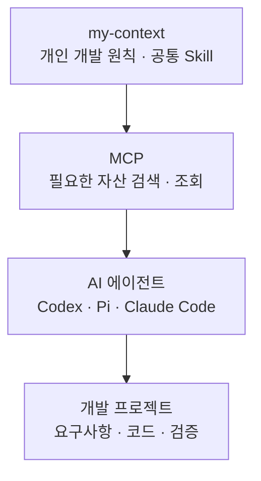

# my-context

my-context는 여러 프로젝트에서 재사용할 개발 원칙과 AI 에이전트 작업 절차를 관리하는 저장소예요. 프로젝트가 바뀌어도 같은 판단 기준을 반복해서 설명하지 않도록, 필요한 내용을 MCP로 찾아 활용할 수 있어요.

## 어떻게 동작하나요?



my-context는 원칙과 절차를 제공하고, 실제 개발과 검증은 각 프로젝트에서 수행해요.

## 이런 상황에서 사용해요

| 이런 상황에서 | 무엇을 하나요? |
| --- | --- |
| [구현 방법이 고민될 때](content/personal/lookup-implementation-strategy/knowledge.md) | 기존 코드와 계약을 확인하고 구현 대안을 비교해요. |
| [작업이 복잡해졌을 때](skills/development-workflow/SKILL.md) | 작업 의존성, 검증 및 인계 방식을 정리해요. |
| [코드 구조가 복잡할 때](content/personal/lookup-responsibility-driven-design/knowledge.md) | 구성 요소의 책임과 협력 관계를 검토해요. |
| [테스트를 정리할 때](content/personal/lookup-testing-principles/knowledge.md) | 중요한 동작과 검증할 테스트를 선택해요. |
| [반복되는 문제가 있을 때](content/personal/lookup-preventive-engineering/knowledge.md) | 원인과 재발 방지 필요성을 판단해요. |
| [개발 경험을 정리할 때](skills/extract-development-insights/SKILL.md) | 다른 프로젝트에도 쓸 수 있는 원칙 후보를 찾아요. |

## 시작하기

원격 MCP는 저장소 클론 없이 사용할 수 있어요. 운영자가 허용한 이메일로 로그인해야 해요.

1. Codex에 연결해 주세요.
   ```bash
   codex mcp add my-context --url https://minylee.my-context.workers.dev/mcp
   ```
2. 브라우저에서 로그인해 주세요. 필요하면 `codex mcp login my-context`를 실행해 주세요.
3. 새 세션에서 `my-context의 chub_list를 호출해줘`라고 요청해 연결을 확인해 주세요.
4. 작업을 요청해 보세요.
   ```text
   my-context를 사용해서 지금 구현하려는 기능의 설계를 검토해줘.
   my-context를 참고해서 이 작업의 구현 계획을 세워줘.
   ```

기본적으로 자산은 명시적으로 요청할 때 조회해요. [선택적 자동 활용](docs/LOCAL-SETUP.md#선택적-조회-정책)은 별도 동의가 필요하며, MCP 연결이나 Skill 설치만으로 허용되지 않아요. 지식 변경과 배포에도 별도 승인이 필요해요.

> **공개 범위:** 이 저장소의 원본은 공개되어 있어요. Cloudflare Access는 운영 MCP 접속만 제한하므로 비공개 정보를 커밋하기 전에 공개 범위를 확인해 주세요.

## 더 알아보기

- [로컬 설정](docs/LOCAL-SETUP.md) — 설치, 다른 에이전트 연결, 선택적 활용 정책
- [개발 지식 관리](skills/manage-dev-knowledge/SKILL.md) — 개인 원칙 조회 및 승인된 변경
- [개발 안내](AGENTS.md) · [운영과 배포](docs/DEPLOYMENT.md) — 유지보수, 배포와 검증
