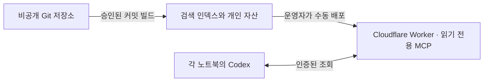

# my-context

**프로젝트나 노트북이 바뀌어도 내 개발 원칙과 작업 절차를 다시 설명할 필요가 없어요.**

my-context는 개인 자산을 비공개 Git 저장소에 보관해요. 개인 자산에는 개발 원칙, 작업 절차, 템플릿, 보조 스크립트가 있어요. Codex는 원격 MCP에서 필요한 개인 자산을 조회해요.

## Codex 연결하기

각 노트북에 MCP 연결을 한 번 등록해요. 조회할 때는 저장소 클론이나 별도 Skill 설치가 필요 없어요.

1. Codex를 실행할 환경의 `MY_CONTEXT_MCP_TOKEN`에 운영자가 공유한 Bearer 토큰을 설정해 주세요.
2. 아래 명령을 실행해 주세요.

   ```bash
   codex mcp add my-context-cloudflare \
     --url https://my-context.my-context.workers.dev/mcp \
     --bearer-token-env-var MY_CONTEXT_MCP_TOKEN
   ```

3. 새 Codex 세션을 열어 주세요.
4. 아래 요청으로 연결을 확인해 주세요.

   ```text
   my-context-cloudflare의 chub_list를 직접 호출해줘.
   ```

호출이 성공하면 연결된 거예요. 배포된 개인 자산이 없으면 목록이 비어 있어요. `401`이 나오면 Codex 실행 환경의 토큰을 확인해 주세요.

데스크톱 앱에서는 Streamable HTTP 연결을 등록해 주세요. 토큰 파일을 읽는 명령을 쓴다면 `http_headers_helper` 값을 문자열로 설정해 주세요. [Codex MCP 연결 안내](https://learn.chatgpt.com/docs/extend/mcp)

## 개인 자산 사용하기

```text
my-context에서 내 도메인 스토리텔링 절차를 찾아줘.
절차에 딸린 템플릿을 가져와줘.
이 프로젝트의 요구사항에서 행위자와 업무 흐름을 정리해줘.
```

Codex는 요청한 개인 자산만 조회해요. 검색에는 이름·설명·태그를 사용해요. 검색 결과가 없으면 `domain storytelling`처럼 관련 영문 키워드를 써 보세요.

개인 자산을 적용할 때는 현재 프로젝트의 규칙이 우선해요. 스크립트 실행과 결과 검증도 현재 프로젝트에서 진행해요.

## 조회와 배포 흐름



Codex는 Worker에 배포된 버전을 조회해요. 새 커밋은 Worker를 다시 배포한 뒤 조회할 수 있어요.

## 개인 자산 배포하기

| 자산 | 저장 위치 |
| --- | --- |
| 개발 원칙과 경험 | `content/personal/` 아래 항목 폴더의 `knowledge.md`와 검색용 `SKILL.md` |
| 작업 절차 | `skills/<폴더 이름>/SKILL.md` |
| 템플릿과 보조 스크립트 | 해당 작업 절차의 폴더 |

작업 절차의 `name`은 폴더 이름과 같아야 해요. 배포할 폴더 이름을 [배포 목록](publish-skills.json)에 추가해 주세요. 변경안 검토와 승인 절차는 [관리 Skill](skills/manage-dev-knowledge/SKILL.md)에 있어요.

1. 승인된 변경을 Git에 커밋해 주세요.
2. 저장소 밖의 비밀 파일에 `MY_CONTEXT_MCP_TOKEN`을 설정해 주세요.
3. 저장소 루트에서 아래 명령을 실행해 주세요. Cloudflare 로그인과 Node.js 22.22.0 이상이 필요해요.

   ```bash
   npm ci &&
   npm run worker:build -- HEAD &&
   npm run worker -- deploy --secrets-file /path/to/worker-secrets.env
   ```

4. 새로 배포한 개인 자산을 Codex에서 조회해 주세요.

제품의 방향은 [VISION](docs/VISION.md)에 있어요. 출발점이 된 사용자 문제는 [PROBLEM](docs/PROBLEM.md)에 있어요.
