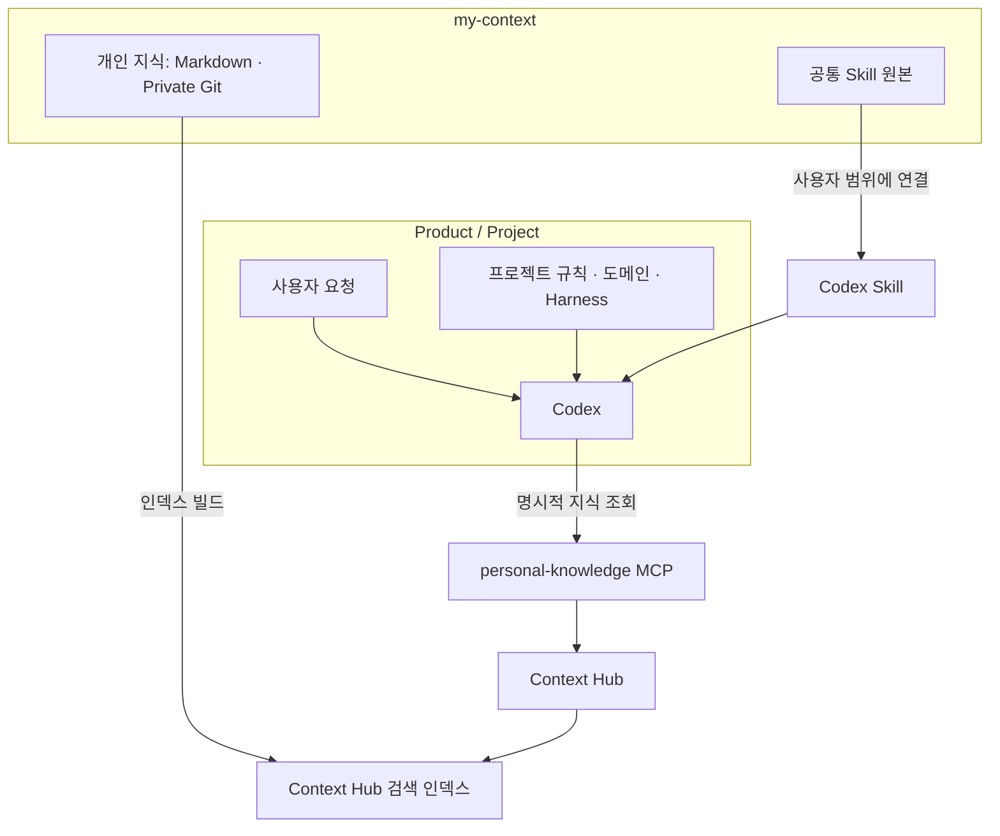
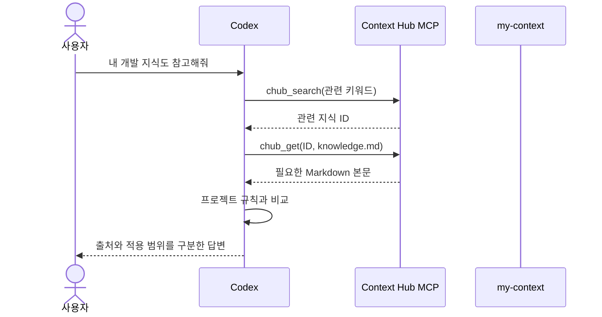

# my-context

**내 개발 지식은 한곳에 남겨두고, 필요한 프로젝트에서만 꺼내 쓸 수 있어요.**

개발하다 보면 경험을 통해 얻은 판단 기준과 원칙이 생깁니다. 그런데 프로젝트를 옮기거나 새로운 에이전트 대화를 열 때마다 그 배경을 다시 설명하기는 번거로워요. 모든 프로젝트의 지침 파일에 개인 철학을 복사하면 지금 프로젝트의 규칙과 섞일 수도 있습니다.

my-context는 **개인 개발 지식을 Git의 일반 Markdown으로 보존**하고, Codex가 명시적으로 요청받았을 때 **Context Hub MCP로 필요한 내용만 찾아 읽도록** 연결합니다. 여러 프로젝트에서 쓸 수 있는 **공통 Skill의 원본**도 함께 관리합니다. 특정 프로덕트에 맞춘 Harness는 해당 프로젝트가 소유합니다.

## 실제로 사용해 보면

예를 들어 새 프로젝트에서 기술 선택을 검토한다고 해볼게요.

```text
이 프로젝트의 기술 선택을 검토해줘.
내 개인 개발 지식에 관련된 판단 기준이 있다면 찾아서 참고해줘.
현재 프로젝트의 요구사항과 충돌하는 부분은 구분해서 설명해줘.
```

Codex는 현재 프로젝트의 코드와 규칙을 확인하고, `personal-knowledge` MCP를 통해 관련 지식을 검색합니다. 찾은 Markdown은 **판단에 참고할 Context**이지, 프로젝트 규칙을 덮어쓰는 지시가 아닙니다.

새로운 지식을 남기고 싶을 때는 이렇게 말할 수 있어요.

```text
내 개발 지식에 이 경험을 등록하고 싶어.
기존 지식과 중복되는지 확인하고, 저장할 Markdown 변경안을 먼저 보여줘.
승인 전에는 파일을 수정하지 마.
```

Codex의 `manage-dev-knowledge` Skill이 기존 자료를 확인하고 변경안을 제안합니다. 실제 지식 반영과 원격 Push는 각각 승인된 범위에서만 진행합니다.

> **현재 상태:** 초기 구축 과정에서 사용한 V1·V2 검증 자료는 모두 정리했습니다. 아래 예시는 사용 방식 설명이며, 실제 개인 개발 철학이 이미 등록돼 있다는 뜻은 아닙니다.

## 어떻게 동작하나요?

**지식의 원본, 지식에 접근하는 방법, 프로젝트의 실행 책임을 구분**합니다.



지식을 조회하는 경로는 **Product의 Codex → MCP → Context Hub → my-context의 지식**입니다. MCP는 인터페이스일 뿐, 원본 데이터를 소유하거나 Product의 의사결정을 대신하지 않습니다.

공통 Skill은 별도 경로입니다. `my-context/skills/`에 원본을 두고 Codex의 Skill 기능으로 로드합니다. **Skill을 사용하기 위해 반드시 MCP를 거치는 것은 아닙니다.**

### 검색은 두 단계로 진행돼요



현재 검색은 주로 이름·영문 설명·태그를 사용합니다. 한국어 전체 본문의 의미 검색을 지원하는 구조는 아닙니다. 관련 지식이 없다면 없다고 알려야 하며, 임의로 개인 취향을 만들어내지 않습니다.

## Knowledge, Skill, Harness는 어떻게 다른가요?

| 구분 | 무엇을 담나요? | 어디서 관리하나요? |
| --- | --- | --- |
| **Knowledge** | 개발 철학·경험·판단의 근거 | `my-context/content/` |
| **공통 Skill** | 여러 프로젝트에서 재사용할 작업 절차 | `my-context/skills/` |
| **프로젝트 Harness** | 해당 도메인의 실행·테스트·피드백 구조 | 각 Product 저장소 |

개인 지식과 공통 Skill은 같이 보관하지만 **서로 다른 역할**입니다. Harness는 특정 프로덕트의 제약과 가까울수록 효과적이므로 `my-context`의 필수 계층으로 만들지 않습니다. 공통 Skill 안에 필요한 작은 스크립트·참조 문서·템플릿은 둘 수 있습니다.

이 기준과 장기 방향은 [비전](docs/VISION.md)에, 사용자 관점에서 출발한 문제는 [문제기술문](docs/PROBLEM.md)에 정리했습니다.

## 설치 및 첫 사용

현재 구현은 macOS의 로컬 Codex와 Node.js **18 이상**을 기준으로 합니다. Private Git 저장소를 복제한 후 루트에서 실행하세요.

```bash
npm ci
npm run setup
npm run build
npm run install:user
```

`install:user`는 기존 설정을 보존하면서 `personal-knowledge` MCP를 `~/.codex/config.toml`에 등록하고, `manage-dev-knowledge` Skill을 `~/.agents/skills/`에 심볼릭 링크로 연결합니다. 이미 동일하게 설치된 항목은 유지하고 충돌 시 임의로 덮어쓰지 않습니다.

설치 확인은 쓰기 없이 진행할 수 있습니다.

```bash
npm run install:user -- --check
```

새 로컬 Codex 대화에서 다음처럼 요청해 보세요.

```text
내 개인 개발 지식에서 테스트 관련 내용을 찾아줘.
```

아직 지식이 없다면 검색 결과가 없는 것이 정상입니다. 실제로 지식을 등록한 뒤에는 새 대화에서 검색·본문 조회를 확인할 수 있습니다.

## 지식 등록과 갱신

현재 지식 파일은 아래처럼 관리합니다.

```text
content/personal/lookup-<name>/
├── SKILL.md       # Context Hub 검색용 이름·설명·태그·진입 안내
└── knowledge.md   # 실제 지식 원본
```

여기서 `content/.../SKILL.md`는 **검색용 진입 파일**입니다. `skills/manage-dev-knowledge/SKILL.md` 같은 **Codex 실행 Skill과는 다릅니다.**

승인된 지식을 변경하면 `npm run build`로 로컬 인덱스를 재생성하고, 필요하면 MCP 연결을 새로 열어 실제 검색과 본문이 최신인지 확인합니다. 일반적인 운영 순서는 **기존 지식 확인 → 변경안 검토 → 승인 → 원본 반영 → Git 반영 → 인덱스 갱신 → 실제 조회 확인**입니다.

```bash
npm run build
npm run search -- testing --json
npm run get -- personal/lookup-<name> --file knowledge.md
```

Git에 저장되는 것은 원본 Markdown과 관리 코드입니다. `.generated/` 인덱스와 `.local/`의 컴퓨터별 설정은 재생성 가능한 로컬 데이터로 Git에서 제외합니다.

## 사용 전 알아둘 점

- 개인 지식은 **명시적인 요청이 있을 때만** 조회합니다. 모든 개발 요청에 자동 주입하지 않습니다.
- **현재 프로젝트의 요구사항과 계약이 우선**합니다. 개인 지식은 참고 Context입니다.
- 지식 등록·수정·삭제 및 원격 Push는 **승인 범위**를 따라야 합니다.
- 검색은 아직 메타데이터 중심입니다. 적절한 영문 키워드가 발견 가능성에 영향을 줍니다.
- 현재 설치 스크립트가 연결하는 Skill은 `manage-dev-knowledge` 하나입니다. 향후 공통 Skill의 설치 정책은 실제 추가 시 확장합니다.
- 설치와 빌드는 로컬에서 이루어집니다. Private 저장소를 공개하거나 Context Hub의 공개 서비스에 지식을 업로드하지 않습니다.

구현·설정 문제를 확인해야 할 때만 관련 스크립트와 [기존 구축 기록](tasks/state.json)을 참고하면 됩니다. 일반적인 지식 조회에서 구축 이력을 먼저 읽을 필요는 없습니다.
